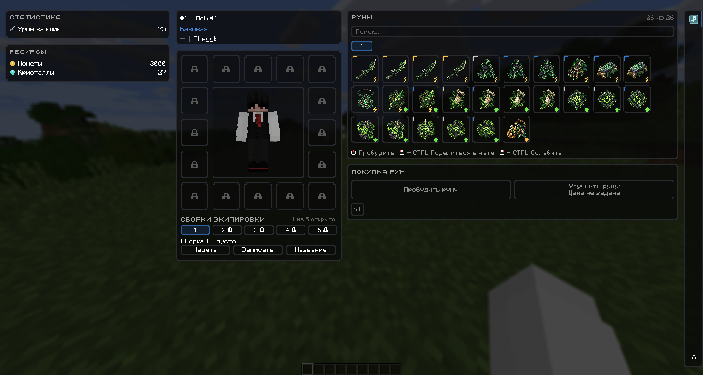

# RE:volution Resource Pack — Minecraft 1.12.2

Набор ресурсов игрового режима **RE:volution**: текстуры рун, которые загружаются отдельно от Java-кода основного Forge-мода.

**Текущая версия: `v1.1.0`**

[Скачать набор ресурсов](https://github.com/Theyyk/re-volution-resource-pack/releases/tag/v1.1.0) · [Документация на русском](docs/README.md) · [Русские описания версий](docs/releases/README.md)

## Возможности

- 11 уникальных текстур для 26 фиксированных позиций первого статуса **Яд**.
- Два варианта: **64×64** и **128×128**, с одинаковыми именами файлов и путями ресурсов.
- Прозрачные PNG в формате RGBA с 8-битными каналами.
- Minecraft **1.12.2**, формат набора ресурсов **3**, пространство имён `customguimod`.
- Автоматическая проверка текстур и сборка двух ZIP-архивов.

Набор содержит изображения рун. Геометрию интерфейса, ранги, состояние коллекции, покупку и пробуждение определяет основной мод.

## Совместимость

| Компонент | Версия |
|---|---|
| Minecraft | `1.12.2` |
| Forge | `14.23.5.2859` |
| Текущий RE:volution Mod | `v1.1.7` |
| RE:volution Resource Pack | `v1.1.0` |

[RE:volution Mod v1.1.7](https://github.com/Theyyk/re-volution-mod/releases/tag/v1.1.7) использует этот набор ресурсов. Шрифты интерфейса и сведения об их источнике находятся в [репозитории мода](https://github.com/Theyyk/re-volution-mod/blob/main/docs/permissions/cristalix.md).

## Скриншот интерфейса

Полный вид с набором ресурсов v1.1.0. Кадр снят на моде v1.1.4 и показывает текстуры, используемые также текущей версией мода.

## Установка и запуск

1. Установите [RE:volution Mod v1.1.7](https://github.com/Theyyk/re-volution-mod/releases/tag/v1.1.7) на клиент и сервер с Forge 1.12.2.
2. Скачайте **один** вариант из [релиза набора ресурсов v1.1.0](https://github.com/Theyyk/re-volution-resource-pack/releases/tag/v1.1.0):
   - `re-volution-resource-pack-v1.1.0-64x64.zip`;
   - `re-volution-resource-pack-v1.1.0-128x128.zip`.
3. Поместите ZIP без распаковки в папку `resourcepacks` используемого профиля Minecraft.
4. Включите набор в настройках ресурсов. Другой набор с более высоким приоритетом может перекрывать эти текстуры.
5. Запустите клиент, подключитесь к серверу и откройте интерфейс клавишей `C`.

Выберите один вариант: при включении обоих Minecraft использует изображения из набора с более высоким приоритетом. Разрешение PNG не меняет размер слотов интерфейса.

[Подробная установка и устранение проблем](docs/setup.md). Настройка сервера и MongoDB описана в [документации мода](https://github.com/Theyyk/re-volution-mod/blob/main/docs/setup.md).

## Документация

[Оглавление](docs/README.md) содержит каталог рун, правила визуального набора, структуру ресурсов и процесс выпуска. Русская история хранится в `docs/releases/`, английские описания и ZIP-архивы — в [GitHub Releases](https://github.com/Theyyk/re-volution-resource-pack/releases).

## Лицензия

Проект распространяется по лицензии [MIT](LICENSE).
