# RE:volution Resource Pack — Minecraft 1.12.2

Официальный набор визуальных ресурсов RE:volution для Minecraft 1.12.2. Репозиторий содержит rune-текстуры, их варианты разрешения, документацию, release automation и frozen legacy production manifest для старых launcher EXE.

**Текущая версия Resource Pack: `v1.1.0`.**

[Скачать Resource Pack](https://github.com/Theyyk/re-volution-resource-pack/releases/tag/v1.1.0) · [Документация](docs/README.md) · [История версий](docs/releases/README.md)

## Назначение

Resource Pack отвечает только за визуальные ассеты. Игровая логика, ранги, состояние коллекций, экономика, Realm-модель и серверная авторитетность находятся в [RE:volution Mod](https://github.com/Theyyk/re-volution-mod).

Текущий namespace rune-ассетов: `customguimod`.

## Возможности

- 11 уникальных текстур для 26 фиксированных позиций первого статуса **Яд**.
- Два варианта: **64×64** и **128×128** с одинаковыми путями и именами файлов.
- Прозрачные PNG в RGBA с 8-битными каналами.
- Minecraft **1.12.2**, Resource Pack format **3**.
- Автоматическая валидация PNG, metadata и структуры.
- Автоматическая сборка двух ZIP-вариантов.
- Frozen legacy production manifest для совместимости со старыми launcher EXE. Актуальный production manifest теперь принадлежит репозиторию RE:volution Client.

## Совместимость

| Компонент | Совместимость |
|---|---|
| Minecraft | `1.12.2` |
| Forge | `14.23.5.2859` |
| RE:volution Mod | актуальная стабильная версия |
| RE:volution Resource Pack | `v1.1.0` |

Resource Pack предназначен для [актуальной стабильной версии RE:volution Mod](https://github.com/Theyyk/re-volution-mod/releases/latest).

## Структура репозитория

- `assets/customguimod/` — основной 128×128 набор ресурсов;
- `variants/64x64/` — 64×64 вариант с той же структурой путей;
- `docs/` — установка, каталог ресурсов, release notes и архивные материалы;
- `.github/scripts/` — проверки и вспомогательная release automation;
- `.github/workflows/` — CI и Resource Pack release build;
- `client/` — frozen legacy production manifest для совместимости со старыми launcher EXE; активный production manifest публикуется из RE:volution Client.

## Предпросмотр ресурсов

Предпросмотр ниже строится напрямую из PNG, входящих в репозиторий.

### 64×64

  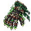
  
  
  
  
  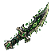
  
  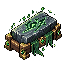
  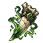
  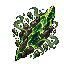
  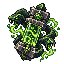

### 128×128

  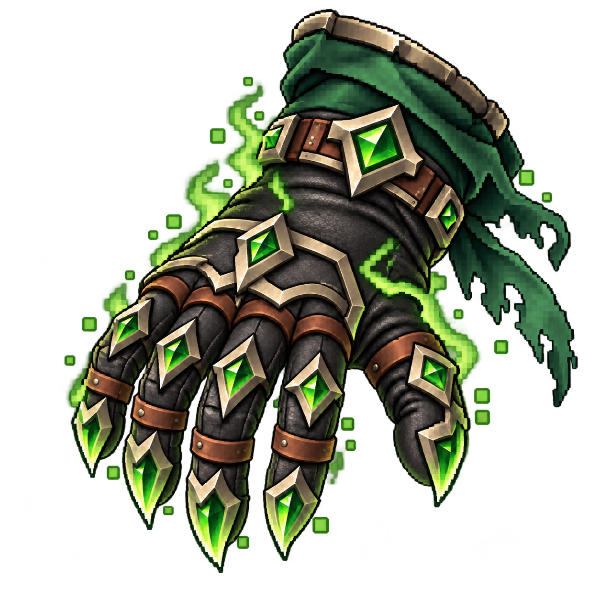
  
  
  
  
  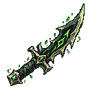
  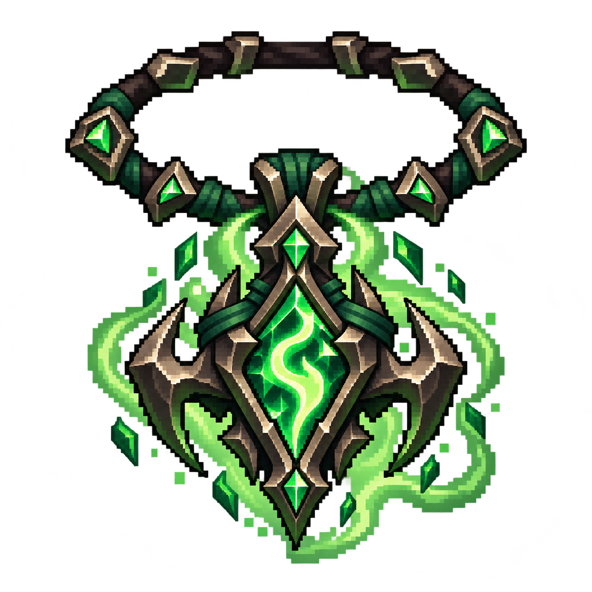
  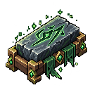
  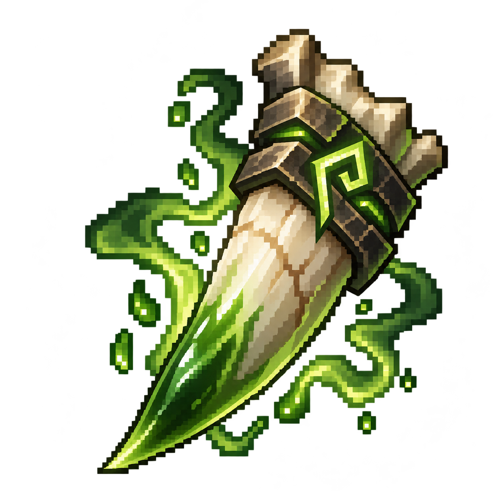
  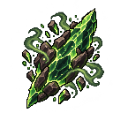
  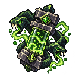

Исторические GUI-скриншоты сохранены в [`docs/archive/screenshots/`](docs/archive/screenshots/). Они не считаются актуальным preview интерфейса gameplay-мода.

## Установка

1. Установите [актуальную версию RE:volution Mod](https://github.com/Theyyk/re-volution-mod/releases/latest) с Forge 1.12.2.
2. Скачайте **один** вариант из [релиза v1.1.0](https://github.com/Theyyk/re-volution-resource-pack/releases/tag/v1.1.0):
   - `re-volution-resource-pack-v1.1.0-64x64.zip`;
   - `re-volution-resource-pack-v1.1.0-128x128.zip`.
3. Поместите ZIP без распаковки в `resourcepacks` используемого профиля Minecraft.
4. Включите набор в настройках ресурсов.
5. Подключитесь к серверу и откройте gameplay GUI клавишей `C`.

Если включено несколько Resource Pack, набор с более высоким приоритетом может перекрывать rune-текстуры. Разрешение PNG не меняет размер GUI-слотов.

[Подробная установка и troubleshooting](docs/setup.md).

## Сборка и CI

CI проверяет исходные PNG и metadata, затем собирает два release ZIP с ожидаемой структурой. Release automation не должна изменять содержимое ассетов во время сборки: артефакты формируются из уже проверенных файлов репозитория.

`main` является стабильной веткой. `develop` используется для подготовленных изменений Resource Pack перед продвижением в `main`.

## Legacy production manifest

`client/manifest.production.signed.json` сохранён как frozen legacy manifest для старых launcher EXE, которые продолжают обращаться к прежнему distribution URL.

Этот файл больше не участвует в активном production rollout и не обновляется при новых gameplay release.

Актуальный production manifest принадлежит репозиторию [RE:volution Client](https://github.com/Theyyk/re-volution-client) и публикуется как `manifest/manifest.production.signed.json`. Stable gameplay release из `RE:volution Mod` запускает Client-owned rollout через `repository_dispatch`, а периодическая проверка в Client остаётся fallback.

Resource Pack repository больше не подписывает и не публикует новые production gameplay manifest.

## Документация

[docs/README.md](docs/README.md) содержит каталог рун, правила структуры, установку и release-процесс. Версионные документы хранятся в `docs/releases/`, опубликованные ZIP и release notes — в [GitHub Releases](https://github.com/Theyyk/re-volution-resource-pack/releases).

README описывает текущее состояние репозитория, а release notes фиксируют конкретные версии.

## Лицензирование

Репозиторий использует раздельное лицензирование:

- служебный код и инструменты в `.github/scripts/**` и `tools/**` распространяются по [MIT License](LICENSE);
- визуальные и игровые ассеты, включая `assets/**`, `variants/**`, текстуры, изображения интерфейса, скриншоты и другие медиа, защищены [RE:volution Asset License](ASSETS-LICENSE.md).

Визуальные ассеты **не разрешены для свободного копирования, модификации, переиспользования или распространения вне официального проекта RE:volution без отдельного письменного разрешения**.
